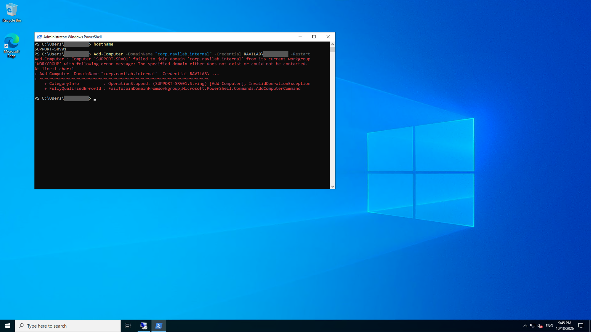
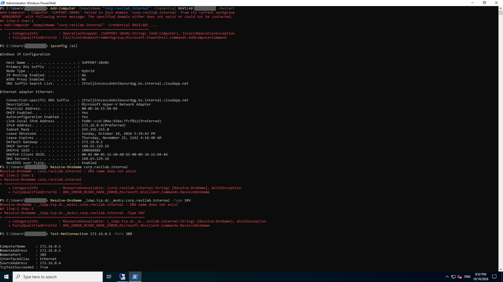
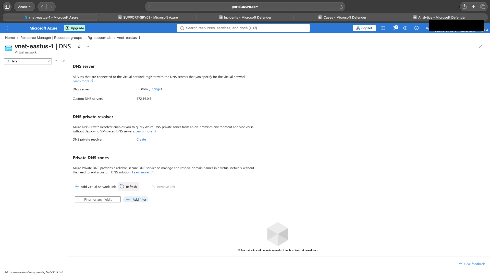
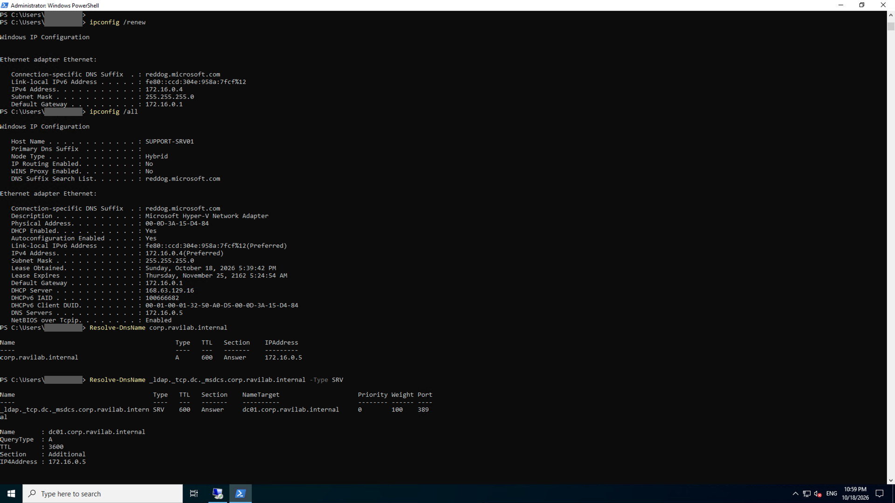
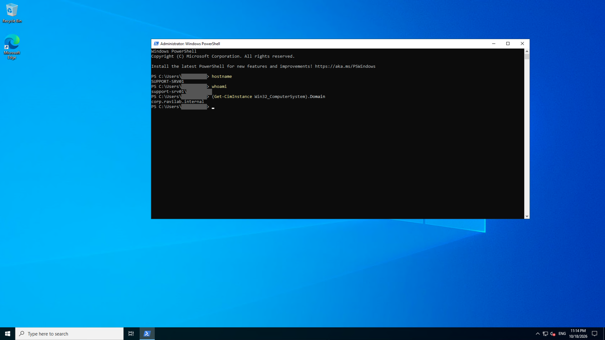

# Ticket 01: SUPPORT-SRV01 cannot join the domain

**Date and time:** October 18th, 2026, 5:45 PM to 7:15 PM EDT (21:45 to 23:15 UTC)\
**Requested by:** IT Infrastructure team (lab scenario)\
**Reported symptom:** "The new server SUPPORT-SRV01 won't join the domain. It says the domain does not exist or could not be contacted."\
**Impact:** SUPPORT-SRV01 cannot join `corp.ravilab.internal`, so domain accounts cannot sign in to it and Group Policy cannot be applied to it. The domain itself and DC01 are working. Only this server is affected.\
**Priority:** Medium. It is a new server build that nobody depends on yet, so no users are currently down, but the server cannot go into service until it is joined.

## Investigation (in order, with the result of each check)
1. **Reproduced the error.** `Add-Computer -DomainName "corp.ravilab.internal" -Credential RAVILAB\<admin> -Restart` failed with: *"The specified domain either does not exist or could not be contacted."*
2. **Which DNS server is the server using?** My first instinct was to check the network configuration of SUPPORT-SRV01. `ipconfig /all` showed the server on `172.16.0.4` using DNS server `168.63.129.16`. That is Azure-provided DNS, the built-in resolver every Azure VM uses by default, and not our domain controller DC01 on `172.16.0.5`.
3. **Can it find the domain?** `Resolve-DnsName corp.ravilab.internal` returned `DNS name does not exist`. Azure DNS has no records for our private domain.
4. **Can it find a domain controller?** Computers locate a domain controller through the DNS SRV record `_ldap._tcp.dc._msdcs.corp.ravilab.internal`. My lookup returned `DNS name does not exist`. Note: in the screenshot I typed `_ldap.tcp` without the underscore before `tcp`. Since the domain name itself did not resolve in step 3, the correctly typed record could not have resolved either. The correct query is shown working in the verification screenshot.
5. **Is the network path to DC01 open?** `Test-NetConnection 172.16.0.5 -Port 389` returned `TcpTestSucceeded : True`. LDAP on DC01 was reachable, so the network and firewall were fine. The problem was DNS only.

## Root cause
The problem was not on the machine but in the Azure virtual network configuration. `vnet-eastus-1` was still set to Azure-provided DNS, so SUPPORT-SRV01 asked `168.63.129.16` where `corp.ravilab.internal` was. Azure DNS knows nothing about our private domain, so the lookup failed and `Add-Computer` could not find a domain controller. Only DC01 (`172.16.0.5`) holds the DNS zone and SRV records for the domain.

## Fix
1. In the Azure Portal I went to `vnet-eastus-1 > Settings > DNS` and clicked **Change** next to the DNS server setting.
2. I changed the DNS server from Azure-provided to **Custom**, entered DC01's private IP `172.16.0.5` and saved.
3. VMs pick up the new DNS server when their DHCP lease refreshes, so I ran `ipconfig /renew` on SUPPORT-SRV01.
4. I re-ran `Add-Computer -DomainName "corp.ravilab.internal" -Credential RAVILAB\<admin> -Restart`. This time it found DC01, joined the domain and restarted the server.

## Verification
1. `ipconfig /all` now shows `DNS Servers : 172.16.0.5`.
2. `Resolve-DnsName corp.ravilab.internal` returns `172.16.0.5`.
3. `Resolve-DnsName _ldap._tcp.dc._msdcs.corp.ravilab.internal -Type SRV` returns `dc01.corp.ravilab.internal` on port 389.

4. After the restart, `(Get-CimInstance Win32_ComputerSystem).Domain` returns `corp.ravilab.internal`, which confirms SUPPORT-SRV01 is a member of the domain.

## Prevention
1. Point the virtual network's DNS at the domain controller as soon as the DC is promoted, before building or joining any member servers.
2. Set DNS at the virtual network level in Azure, not inside the Windows guest, so every VM gets the right server automatically.
3. Keep the DNS forwarder to `168.63.129.16` on DC01 so machines using it can still resolve internet and Azure names.
4. In production, run a second domain controller and list both in the VNet DNS settings, so losing one DC does not stop logons and domain joins.

## What I would tell the user
The new server could not find our domain because the network was still sending its lookups to Azure's default directory instead of our own. I changed the network setting so it uses our domain controller, and the server is now joined to the domain. Nothing had to be changed on the server itself.

## Time to resolve
1 hour 30 minutes (5:45 PM to 7:15 PM EDT).
