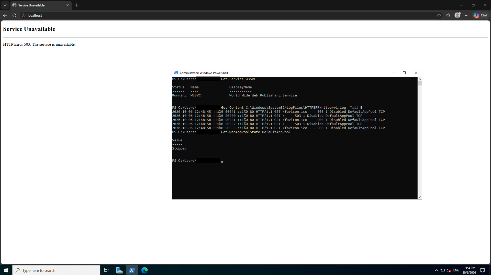
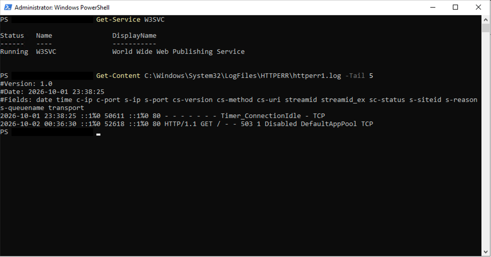
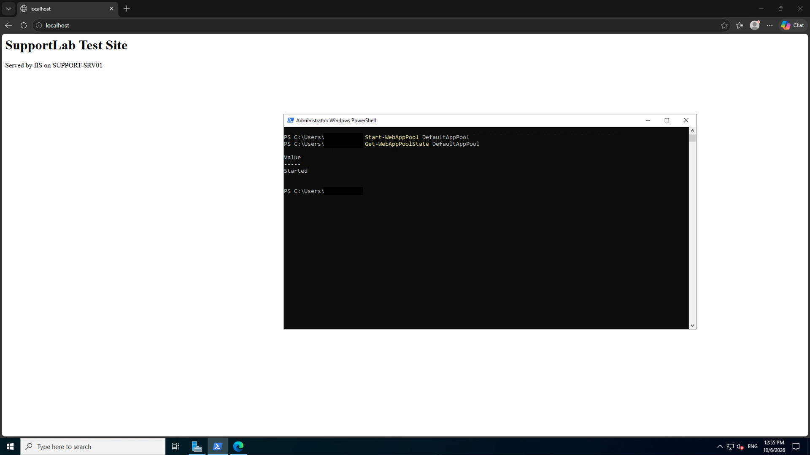

# Ticket 1: Website returns HTTP 503: Service Unavailable

**Date:** October 1st, 2026\
**Time:** 08:36 PM (00:36 UTC, Oct 2nd)\
**Customer:** Ravi Prajapati\
**Reported Problem:** The test website at http://localhost on SUPPORT-SRV01 shows "HTTP Error 503. The service is unavailable."  
**Impact:** The site is totally unavailable to all of the users.

**What I checked:**
My initial action to check if the web server service is running or not. I confirmed the status of web server service with `Get-Service W3SVC`. The cmdlet confirmed that the web server service is running. Afterwards I proceeded to read the http logs with `Get-Content C:\Windows\System32\LogFiles\HTTPERR\httperr1.log -Tail 5`. The log showed `HTTP/1.1 GET / - - 503 1 Disabled DefaultAppPool TCP`. Then I checked the state of DefaultAppPool with `Import-Module WebAdministration; Get-WebAppPoolState DefaultAppPool`. The cmdlet confirmed that the DefaultAppPool was stopped. 

**Root Cause:** The root cause was that the DefaultAppPool was stopped. 

**Fix:**
I went to IIS Manager (Application Pools > DefaultAppPool > Start) and started the DefaultAppPool. I verified the solution by running `Get-WebAppPoolState DefaultAppPool` which returned Started.

## Evidence

Screenshots 1 and 3 are from a reproduction of the same fault on October 6, 2026, where I started the pool from PowerShell with `Start-WebAppPool DefaultAppPool`.

### 1. Initial 503 Service Unavailable Error

### 2. Service Check and HTTPERR Log Analysis

### 3. Verification: Site Restored

