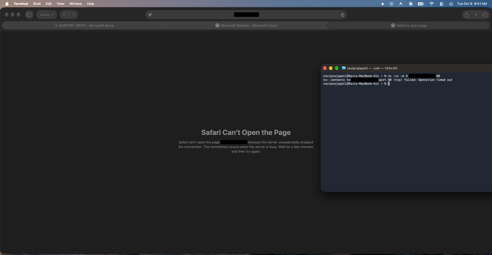
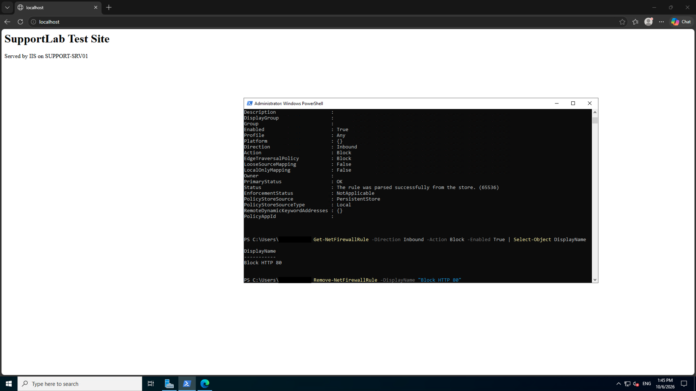
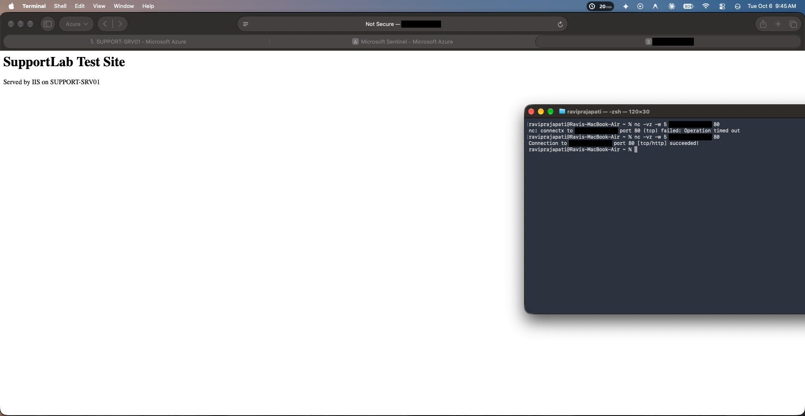

# Ticket 2: External users cannot reach web server on port 80. 

**Date:** October 6th, 2026\
**Time:** 09:41 AM (13:41 UTC)\
**Customer:** Ravi Prajapati\
**Reported Problem:** Navigating to `http://<vm-public-ip>` results in a browser connection time out. \
**Impact:** Public users cannot access this site, internal access (`http://localhost`) is working fine. 

**What I checked:**
I began the investigation by checking `nc -vz` from external device. The browser timed out. Afterwards I checked `http://localhost` on the VM which was working fine proving IIS and the AppPool are healthy. To clear the Azure NSG, I checked if the inbound port 80 rule is allowed.  The rule was present clearing the Azure infrastructure. Hence, the next step would be to check the host firewall. I used `Get-NetFirewallRule -Direction Inbound -Action Block -Enabled True` to check for any blocking rules. The output showed that a rule was blocking inbound traffic on port 80. 

**Root Cause:**
In Windows Defender Firewall, `Block rules` always override `Allow Rules`. Even though the IIS allow rule was enabled, the explicit block rule dropped incoming TCP 80 packets.

**Fix:**
Remove the blocking firewall rule. I used `Remove-NetFirewallRule -DisplayName "Block HTTP 80"`.
 
 **Verification:**
 I ran `nc -vz <vm-public-ip> 80` from external Mac terminal which succeeded immediately, and confirmed the website loaded in the browser.

## Evidence

### 1. Browser and nc time out from outside the VM

### 2. Block rule found and removed

### 3. Verification: port 80 reachable, site loads

