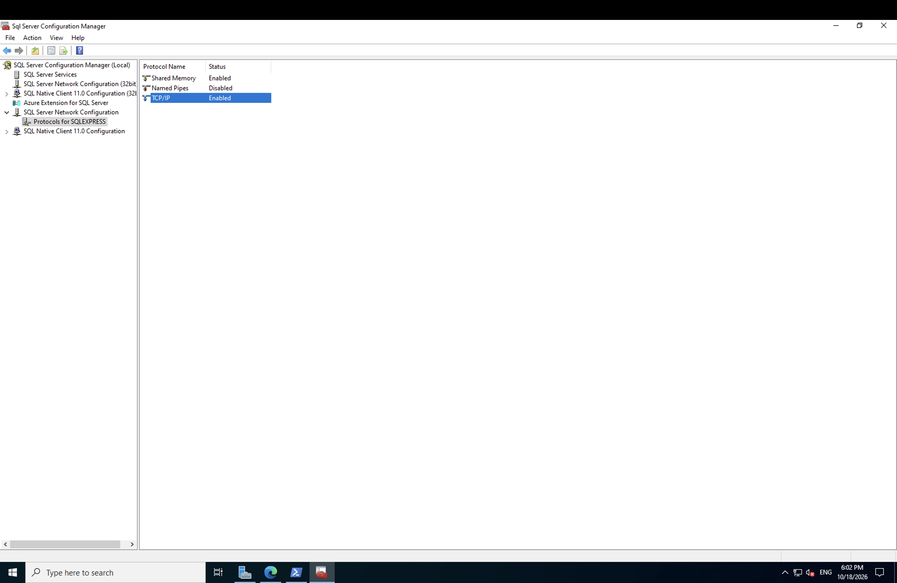
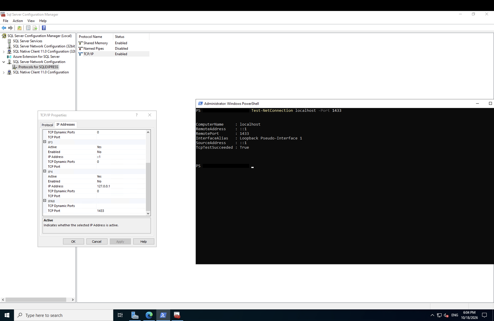

# Ticket 3: SQL Server refuses TCP connections

**Date:** October 6th, 2026\
**Time:** 09:35 PM (01:35 UTC, Oct 7th)\
**Customer:** Ravi Prajapati\
**Reported Problem:**  Applications cannot connect to SQL Server over TCP port 1433. \
**Impact:**  Applications and remote clients cannot query the database over standard network sockets. 

**What I checked:** 
To confirm if the SQL Server is listening on the standard port, I ran `Test-NetConnection localhost -Port 1433` in PowerShell. The output showed `TcpTestSucceeded : False` confirming the database engine was not listening on TCP 1433. Next, I went to SQL Server Configuration Manager and navigated to SQL Server Network Configuration and in Protocols for SQLEXPRESS. I found that TCP/IP was set to Disabled, leaving only Shared Memory active. 

**Root Cause:** SQL Server Express installs by default with TCP/IP network protocol disabled for security and relies on dynamic ports rather than standard static port 1433. 

**Fix:**
First of all I enabled TCP/IP protocol in SQL Server Configuration Manager (Protocols for SQLEXPRESS). Then in TCP/IP properties, I cleared the IPAll TCP Dynamic Ports and set TCP Port to 1433 forcing static port binding. Finally I restarted the SQL Server service for the changes to take effect. Additionally I added a Windows Firewall rule  with `New-NetFirewallRule -DisplayName "SQL 1433" -Direction Inbound -Protocol TCP -LocalPort 1433 -Action Allow`. 

**Verification:**
I checked if the SQL Server is listening on the standard port 1433 with `Test-NetConnection localhost -Port 1433` which returned `TcpTestSucceeded: True`. I also queried the localhost database with `sqlcmd -S tcp:localhost,1433 -E -C -Q "SELECT name FROM sys.databases"`. It successfully returned  `SupportLab`. 

## Evidence

Screenshots 2 and 3 were captured on October 18, 2026.

### 1. TCP/IP disabled in SQL Server Configuration Manager

### 2. TCP/IP enabled

### 3. Verification: IPAll TCP Port 1433 and TcpTestSucceeded True

